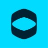

# ✦ Olá, sou a Caroline Lage! | Engenheira de Software & Designer ✦

  
  
  
  

### ✦ Sobre Mim
*Desenvolvedora Full Stack e .NET com experiência em Arquitetura de Sistemas e Design UX/UI. Especializada em backends de alto desempenho em C# / .NET Core, modernização de sistemas legados, integrações complexas de APIs e interfaces intuitivas.*

### ✦ Tech Stack & Ferramentas
#### Backend & Arquitetura

#### Frontend & UX

#### Cloud & DevOps

### ✦ Experiência

 

  
  <a href="https://github.com/carolinelage"><b>Software Engineer</b></a> 
  Symplicity Brasil 
  <small>Sep 2025 – Present</small> 
  <code>Back End</code> <code>.NET Developer</code> <code>Dev Back-End</code> <code>Developer</code>

  

  
  <a href="https://github.com/carolinelage"><b>Software Developer FullStack</b></a> 
  TOTVS S.A 
  <small>Mar 2023 – Sep 2025 • 2.7 years</small> 
  <code>Back End</code> <code>.NET Developer</code> <code>Dev Back-End</code> <code>Developer</code>

  

  
  <a href="https://github.com/carolinelage"><b>Intern Software Developer FullStack</b></a> 
  TOTVS S.A 
  <small>Oct 2021 – Mar 2023 • 1.6 years</small> 
  <code>Back End</code> <code>.NET Developer</code> <code>Dev Back-End</code> <code>Developer</code>

  

  
  <b>Brand & Web Designer | Founder</b> 
  Creative Agency 
  <small>2021 – Present</small> 
  <code>Branding</code> <code>UI/UX</code> <code>Figma</code> <code>Ecommerce</code>

 

### ✦ Vamos Conectar?

